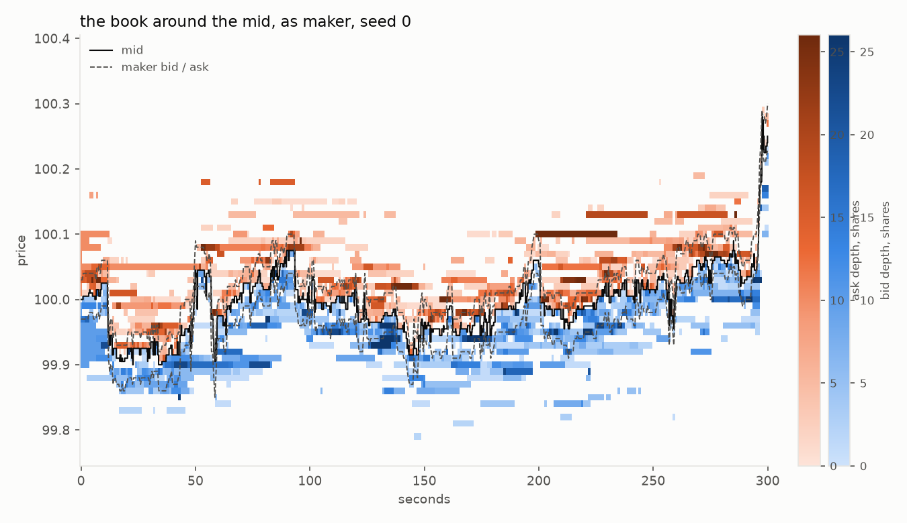
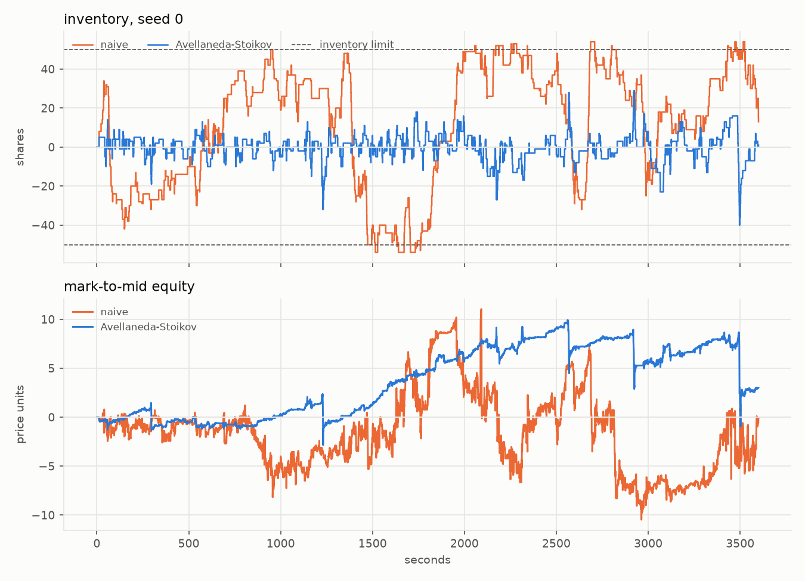
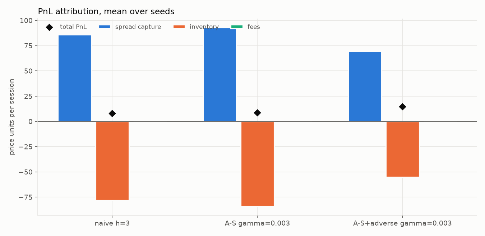
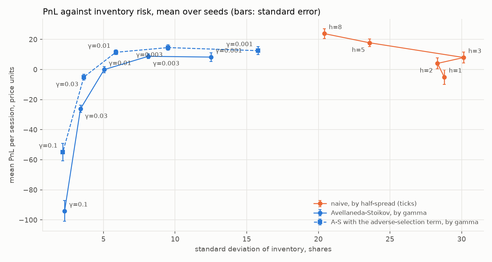
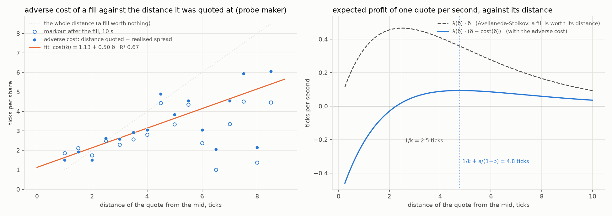
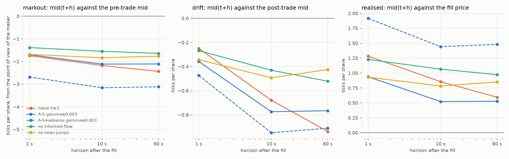
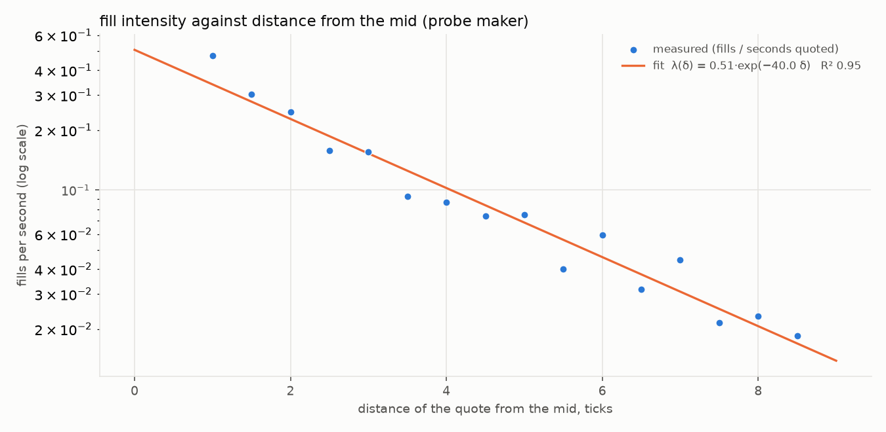
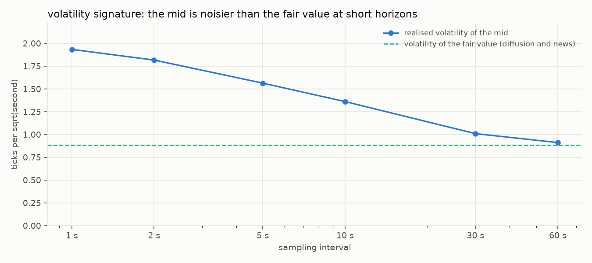
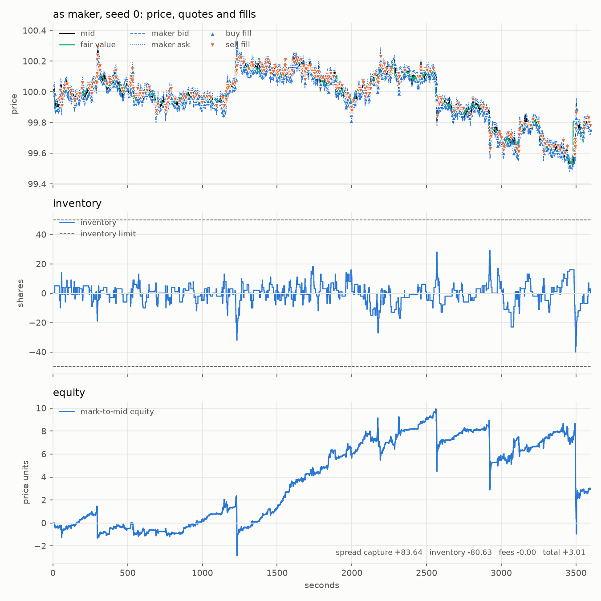

# lob-market-maker

[](https://github.com/oscarschjelderup-sketch/lob-market-maker/actions/workflows/ci.yml)

A limit order book market-making simulator: a price-time-priority matching engine, synthetic order flow with
noise traders, news and informed traders, a market maker that quotes both sides and controls its inventory
(fixed spread, or Avellaneda-Stoikov with or without an adverse-selection term calibrated from the market),
and an accounting layer that says *where* the PnL came from: spread capture, inventory, fees, and how much of
it was adverse selection.

Everything is simulated from a seed. One command regenerates every figure and table in this README.



*Five minutes of the simulated book: bid depth in blue, ask depth in orange, the mid in black, the
Avellaneda-Stoikov quotes dashed. The quotes lean away from the inventory and never cross the touch.*

```python
from lobmm.config import SimConfig
from lobmm.sim import run_session

res = run_session(SimConfig(), seed=0, **{"maker.strategy": "as", "maker.gamma": 0.01})
res.attribution()   # {'total': ..., 'spread_capture': ..., 'inventory': ..., 'fees': ...}
res.markouts()      # one row per fill: markout, impact, drift and realised spread at 1, 10 and 60 seconds
res.summary()       # the numbers one session is judged on
```

## Install

Python 3.11 or newer.

```bash
pip install -e ".[dev]"
```

## Five minutes

```bash
lobmm run                        # one session of the Avellaneda-Stoikov maker: summary, attribution, markouts
lobmm run --strategy as_adverse  # the same with the adverse-selection term in its spread
lobmm run --strategy naive --plot   # the fixed-spread maker, with the session figures written to figures/
lobmm compare --seeds 20         # naive against Avellaneda-Stoikov, with and without the term, on the same 20 seeds
lobmm sweep --param maker.gamma --values 0.001,0.003,0.01,0.03,0.1   # the risk-return frontier
lobmm calibrate                  # sigma, A, k and the adverse-selection term, from probe sessions
lobmm ablate                     # which friction hurts most: latency, fees, informed flow, news, limits
lobmm bench                      # events per second
lobmm figures                    # everything above into figures/ (PNGs, results.json, results.md)
```

Every command takes `--set group.name=value` for any parameter in `lobmm/config.py`, for example
`lobmm run --set flow.informed_rate=0 --set maker.latency=0.2`.

## What is simulated

### The matching engine

`lobmm/book.py` is a limit order book on an integer tick grid, so there is never a floating-point comparison
in the matching path. Each side keeps one FIFO queue per price level; the best price comes from a heap of
level prices with lazy deletion; a cancel is O(1) through a map from order id to order (the order is flagged
dead and skipped when its queue is matched, so nothing is ever removed from the middle of a deque). Order
types: limit, market, post-only (rejected instead of taking), immediate-or-cancel. Partial fills, price
priority, then time priority.

The book counts submitted, filled, cancelled, rejected and unfilled volume, so after any sequence of events
`submitted == resting + 2 * filled + cancelled + rejected + unfilled` can be checked, together with "the book
is never crossed", "every level's depth equals the live quantity queued at it" and "the id map and the queues
agree about which orders are live". The tests check those after every event of a session, and drive the
engine against a deliberately naive reference implementation with random sequences and with Hypothesis.

### The order flow

Three kinds of traders send orders (`lobmm/flow.py`, parameters in `FlowConfig`):

- **Noise traders.** Limit orders arrive as a Poisson process on each side and are placed a geometric
  number of ticks (mean 4) inside the opposite best quote, so they never cross but often improve the touch;
  each rests for an exponential lifetime (mean 10 s) and is then cancelled. Market orders arrive on a random
  side. Sizes are geometric. This is the zero-intelligence book of Cont, Stoikov and Talreja (2010),
  simplified.
- **A latent fair value.** Arithmetic Brownian motion in ticks (0.5 ticks per sqrt-second) plus *news*:
  Poisson jumps (one every two minutes on average, normal with a standard deviation of 8 ticks).
- **Informed traders.** They look at the book about once a second, see the fair value with an error of one
  tick, and when the book is mispriced against it they sweep it: an immediate-or-cancel limit order at their
  estimate, of a geometric size (mean 15). They are what pulls the book after the fair value, and what makes
  the fills of a market maker adversely selected: after a jump it takes them several orders to move the
  book, and the maker is on the wrong side of every one of them.

### The market makers

`lobmm/agents.py`. Each one turns a snapshot of the touch and its own inventory into a bid and an ask.

- **Naive:** a fixed symmetric spread around the mid, whatever the inventory.
- **Avellaneda-Stoikov (2008):** with mid `s`, inventory `q`, risk aversion `γ`, mid volatility `σ`, time to
  the end of the session `τ` and fill-intensity decay `k`:

  ```
  reservation price   r = s − q γ σ² τ
  total spread        δ_a + δ_b = γ σ² τ + (2/γ) ln(1 + γ/k)
  ```

  The quotes sit half the spread either side of the reservation price. Long inventory pushes both quotes
  down (more likely to sell, less likely to buy); higher risk aversion or volatility widens the spread and
  strengthens the lean; the spread shrinks towards `(2/γ) ln(1 + γ/k)` as the session ends.
- **Avellaneda-Stoikov with an adverse-selection term** (`as_adverse`): the same quotes, with a constant added
  to each side of the spread. The model derives its spread for order flow that knows nothing, so that a fill
  is worth its whole distance from the mid; in this market it is not. If a fill quoted `δ` from the mid is
  worth `δ − a − b δ` a moment later, the risk-neutral argument of the model (maximise `λ(δ)` times what the
  fill is worth, with `λ(δ) = A e^(−k δ)`) puts the quote at `1/k + a/(1 − b)` instead of `1/k`, and the
  difference `a/(1 − b)` is the term. `a` and `b` come from the calibration below.
- **Probe:** quotes at a random distance from the mid on each side, every wake. Only used to measure how fill
  intensity decays with distance (the `k` and `A` above), and what a fill at each distance is worth (the `a`
  and `b`).

The simulator (`lobmm/sim.py`) does what the model leaves out: the maker wakes every 0.5 s and cancels and
replaces a quote only when its price changes, so an unchanged quote keeps its queue position; a quote that
would cross the touch is clipped one tick inside it, so the maker never takes liquidity; it stops quoting the
side that would push the inventory past a limit; an optional kill switch cancels everything after a given
drawdown; an optional one-way latency delays both the snapshot on its way to the maker and the orders on
their way to the exchange.

### Where the PnL comes from

`lobmm/accounting.py` records every fill of the maker with the mid at that moment. Mark-to-mid equity then
splits exactly into

```
equity = spread capture + inventory PnL − fees
spread capture = Σ side · (mid − price) · qty        what the maker earned by being passive
inventory PnL  = Σ inventory · Δmid                   what the position gained or lost as the mid moved
```

and for every fill, at horizons of 1, 10 and 60 seconds:

```
markout  = side · (mid(t+h) − mid(t))       where the mid went, against the mid the fill was marked at
impact   = side · (mid_after − mid(t))      the part of that caused by the order that filled the maker
drift    = side · (mid(t+h) − mid_after)    the rest: where the mid went once the trade was done
realised = side · (mid(t+h) − price)        what the fill was worth h seconds later, spread included
```

A negative markout is adverse selection: the maker was filled right before the price moved against it. The
split matters: in this simulation most of it is *impact* (the sweep that reaches a quote three ticks from
the mid also moves the touch), and only the *drift* after the trade is information, which is about zero when
nobody knows anything and negative when informed traders are still catching up with news.

### Calibration

`lobmm calibrate` estimates the two inputs the Avellaneda-Stoikov quotes need from the simulated market
itself, the way one would on real data:

- `σ` from the realised volatility of the mid. The mid is much noisier than the fair value at short horizons
  (bid-ask bounce, thin levels being swept and refilled), so the estimate depends on the sampling interval:
  the volatility signature below. The maker uses the 10-second figure, a horizon on the scale it holds
  inventory for.
- `A` and `k` from probe sessions: seconds of exposure and fills per distance bucket give an intensity per
  bucket, and an OLS fit of `ln(fills / exposure)` on the distance gives `ln A` and `−k`.
- `a` and `b` of the adverse cost of a fill, `cost(δ) = a + b δ`, from the same probe fills: the distance a
  fill was quoted at minus what it was worth ten seconds later. That cost is the markout after the fill plus
  the part of the distance the mid had already closed before the fill came. Bucketed by distance and fitted
  by OLS weighted by shares; the adverse-selection term is `a/(1 − b)`.

The defaults in `MakerConfig` are what this finds on the default flow (three probe sessions of an hour):

| | |
|---|---|
| σ, realised volatility of the mid at 10 s | 1.36 ticks per √s (0.0136 price units) |
| total volatility of the fair value, diffusion and news | 0.89 ticks per √s |
| A, fill intensity at the mid | 0.51 fills per second |
| k, decay of the fill intensity | 40.0 per price unit (0.40 per tick), R² 0.95 |
| a, adverse cost of a fill at zero distance, at 10 s | 1.13 ticks per share |
| b, adverse cost per tick of distance | 0.50 (R² 0.67) |
| adverse-selection term, a/(1 − b) | 2.27 ticks each side (0.0227 price units) |

The signature runs from 1.93 ticks per √s at one second to 0.91 at one minute, where it meets the fair
value: at short horizons the mid is mostly bounce.

## Results

From `lobmm figures`: 20 seeds, one-hour sessions, the calibrated `σ` and `k`. Prices are in price units
(tick 0.01, initial price 100); a PnL of 10 is one thousand ticks.

### Naive against Avellaneda-Stoikov

The fixed-spread maker three ticks from the mid against the Avellaneda-Stoikov maker at γ = 0.003, without
and with the adverse-selection term (2.3 ticks each side, from the calibration), all quoting five shares a
side with an inventory limit of 50, on the same 20 sessions:

| | naive, h = 3 | Avellaneda-Stoikov, γ = 0.003 | A-S with the adverse-selection term |
|---|---|---|---|
| PnL per session, mean | 8.0 | 8.8 | 14.6 |
| PnL per session, std over sessions | 16.3 | 7.0 | 8.2 |
| t-statistic of the mean | 2.2 | 5.7 | 8.0 |
| spread capture | 85.9 | 92.9 | 69.5 |
| inventory PnL | −77.9 | −84.0 | −54.9 |
| fills per session | 769 | 950 | 411 |
| quoted half-spread, mean | 3.3 ticks | 3.1 ticks | 5.3 ticks |
| inventory, std over the session | 30.2 shares | 8.1 shares | 9.5 shares |
| worst inventory | 54 shares | 41 shares | 40 shares |
| share of the session at the inventory limit | 10.6 % | 0 % | 0.1 % |
| mean markout at 10 s, per share | −2.2 ticks | −2.1 ticks | −3.2 ticks |
| of which impact / drift | −1.5 / −0.7 | −1.3 / −0.8 | −2.2 / −0.9 |
| realised at 10 s, per share | +0.9 ticks | +0.5 ticks | +1.4 ticks |





Both makers earn the spread and give most of it back on the inventory they are left holding when the price
moves; what differs is how much inventory that is. The naive maker drifts to its limit and sits there for a
tenth of the session; the Avellaneda-Stoikov maker leans its quotes against the position and keeps it within
a few fills of flat, which is why it earns the same money with less than half the dispersion across sessions.
On the single session above (seed 0) the model made 3.0 against the naive maker's −0.0, with the inventory
never beyond 40 against 54. The adverse-selection term moves the model's quotes from 3.1 to 5.3 ticks: the
maker gets 411 fills instead of 950, each worth 1.4 ticks at ten seconds instead of 0.5, and earns 14.6 a
session instead of 8.8 with the inventory risk unchanged. It is still short of the naive maker at eight
ticks, which earns 23.9; the sweep over the term below says why.

### The risk-return frontier



Avellaneda-Stoikov over its risk aversion:

| γ | PnL, mean | PnL, std | spread capture | inventory PnL | fills | inventory std | max abs inventory | realised at 10 s, ticks per share |
|---|---|---|---|---|---|---|---|---|
| 0.001 | 8.3 | 13.1 | 91.3 | −83.0 | 920 | 12.5 | 46 | 0.7 |
| 0.003 | 8.8 | 7.0 | 92.9 | −84.0 | 950 | 8.1 | 41 | 0.5 |
| 0.01 | −0.0 | 9.1 | 92.2 | −92.3 | 1029 | 5.0 | 31 | 0.2 |
| 0.03 | −26.2 | 10.8 | 84.7 | −110.8 | 1133 | 3.4 | 25 | −0.4 |
| 0.1 | −94.0 | 30.9 | 88.0 | −182.1 | 1195 | 2.3 | 18 | −2.0 |

The same with the adverse-selection term of 2.3 ticks on each side (the dashed curve):

| γ | PnL, mean | PnL, std | spread capture | inventory PnL | fills | inventory std | max abs inventory | realised at 10 s, ticks per share |
|---|---|---|---|---|---|---|---|---|
| 0.001 | 12.5 | 12.0 | 69.9 | −57.4 | 405 | 15.8 | 48 | 1.7 |
| 0.003 | 14.6 | 8.2 | 69.5 | −54.9 | 411 | 9.5 | 40 | 1.4 |
| 0.01 | 11.5 | 7.1 | 71.7 | −60.3 | 443 | 5.9 | 26 | 1.0 |
| 0.03 | −5.0 | 8.9 | 74.5 | −79.5 | 527 | 3.6 | 23 | 0.1 |
| 0.1 | −54.9 | 25.6 | 80.1 | −135.0 | 638 | 2.2 | 17 | −1.7 |

The naive maker over its half-spread:

| h, ticks | PnL, mean | PnL, std | spread capture | inventory PnL | fills | inventory std | max abs inventory | realised at 10 s, ticks per share |
|---|---|---|---|---|---|---|---|---|
| 1 | −5.0 | 21.4 | 104.8 | −109.9 | 2403 | 28.8 | 54 | 0.2 |
| 2 | 4.1 | 16.0 | 98.6 | −94.6 | 1248 | 28.3 | 54 | 0.5 |
| 3 | 8.0 | 16.3 | 85.9 | −77.9 | 769 | 30.2 | 54 | 0.9 |
| 5 | 17.8 | 11.2 | 67.1 | −49.3 | 383 | 23.6 | 54 | 1.9 |
| 8 | 23.9 | 14.6 | 58.8 | −34.9 | 216 | 20.4 | 53 | 3.5 |

Three things are going on.

**The lean works.** Raising γ from 0.001 to 0.01 cuts the standard deviation of the inventory from 12.5 to
5 shares, and the worst position from 46 to 31, while the naive maker sits at 28-30 whatever its spread and
spends a tenth of the session pinned at the limit of 50. At γ = 0.003 the Avellaneda-Stoikov maker earns what
the naive maker earns at three ticks (8.8 against 8.0 per session) with a quarter of the inventory risk and
less than half the dispersion of its PnL across sessions. Past γ = 0.01 the lean is so strong that after one
fill the maker quotes the reducing side one tick inside the touch, is picked off there, and loses: the
inventory PnL goes from −84 to −182 while the spread capture barely moves. With the term the whole curve
moves up: at every γ the maker earns more for about the same inventory risk, and the lean still fails past
γ = 0.01 for the same reason.

**The spread is too tight for a market with informed flow, and the adverse-selection term fixes part of
that.** The model's spread is `(2/γ) ln(1 + γ/k)`, about `2/k` = five ticks in total, whatever happens after
a fill, because Avellaneda and Stoikov derive it for order flow that knows nothing: a fill is worth its whole
distance from the mid. Here it is not. The probe sessions of the calibration measure what a fill at each
distance is worth ten seconds later, and the shortfall against the quoted distance is close to a line,
`cost(δ) = 1.13 + 0.50 δ` ticks: the markout after the fill (hollow markers) plus the part of the distance
the mid had already closed before the fill came.



The argument that gives the model its `1/k` per side, maximise the fill rate times what a fill is worth,
then gives `1/k + a/(1 − b)` = 2.5 + 2.3 = 4.8 ticks (right panel), and `a/(1 − b)` = 2.3 ticks is the
adverse-selection term, added to each side of the model's spread. (The simplest form, the mean cost at the
distance the model quotes at, would be about the same: 2.6 ticks.) With it the maker at γ = 0.003 quotes 5.3
ticks from the mid instead of 3.1, loses more on each fill (3.2 ticks of markout against 2.1) and still
keeps three times as much of its spread (1.4 ticks at ten seconds against 0.5), and earns 14.6 a session
instead of 8.8, two thirds more, with the inventory risk unchanged.

**The calibrated term is too small, and it is the fill-intensity curve that is off, not the cost.** The
naive maker at eight ticks still earns 23.9. Sweeping the term itself at γ = 0.003:

| term, ticks each side | quoted half-spread, ticks | PnL, mean | PnL, std | fills | inventory std | realised at 10 s, ticks per share |
|---|---|---|---|---|---|---|
| 0 | 3.1 | 8.8 | 7.0 | 950 | 8.1 | 0.5 |
| 1 | 4.1 | 11.9 | 7.5 | 617 | 9.6 | 0.9 |
| 2 | 5.1 | 13.6 | 8.7 | 444 | 9.6 | 1.3 |
| 3 | 6.1 | 14.0 | 10.7 | 363 | 11.0 | 1.7 |
| 5 | 8.1 | 21.9 | 11.2 | 267 | 11.6 | 2.6 |
| 8 | 11.1 | 25.4 | 12.8 | 201 | 13.2 | 4.1 |

The PnL keeps rising past the calibrated term, to 25.4 at a term of eight ticks, where the model beats the
naive maker at eight ticks with a third less inventory risk (a standard deviation of 13 shares against 20).
So a lean plus a wide spread is the right structure, and the calibration stops short. The term is not what
is wrong: the sweep's own economics, PnL per share filled against the quoted distance, run at about
`0.29 δ − 0.70` ticks, which is `a/(1 − b)` ≈ 2.4 ticks again. What is wrong is the base distance `1/k`.
The probe maker re-quotes at a new random distance every wake, so it goes to the back of the queue every
time, and its fills thin out with distance at `k` = 0.40 per tick. A maker whose quote keeps its price keeps
its place in the queue: the naive maker's fills thin out at half that rate (383 to 216 fills from five to
eight ticks, 0.19 per tick), and far out they hardly thin at all (267 to 201 fills for the model from eight
to eleven ticks, 0.09 per tick), because out there the fills are the sweeps after news, which do not care
how far the quote is. With `k` = 0.2 per tick the optimum would be 5 + 2.4 ≈ 7.5 ticks, close to what the
sweep finds. The next step is therefore not a better adverse-selection term but a fill-intensity curve
measured on a quote that keeps its queue position, or a model of the queue itself.

### Markouts



Every fill is followed by the mid moving against the maker: about two ticks per share within ten seconds,
for both makers three ticks from the mid. Most of that, 1.3 to 1.5 ticks, is *impact*: the sweep that reached a quote three ticks
from the mid also took the levels in front of it, so the touch moved with the trade. Without informed
traders the impact is still 1.1 ticks (the sweeps are then noise, and rarer: 132 fills a session instead of
950) and the drift afterwards is 0.4 ticks, the book not quite refilling to where it was. With informed
traders and news the drift is 0.7 to 0.8 ticks, and with four times the news it is 1.3 ticks and the fills
stop paying for themselves at ten seconds (realised −0.1 ticks per share). Adverse selection in this market
is, in other words, mostly the cost of being swept, and the informed part of it rises with how much news
there is for the takers to know. With the adverse-selection term the quotes sit five ticks out (dashed): a
fill there is swept harder (impact 2.2 ticks) and drifts a little more (0.9), 3.2 ticks in all, and still
keeps 1.4 ticks of its spread at ten seconds. Wider quotes lose more on each fill and earn more on each fill.

### Ablations

The Avellaneda-Stoikov maker at γ = 0.003 with one thing changed at a time, 20 sessions each:

| | PnL, mean | PnL, std | spread capture | inventory PnL | fees | fills | inventory std | drift at 10 s, per share | realised at 10 s, per share |
|---|---|---|---|---|---|---|---|---|---|
| base | 8.8 | 7.0 | 92.9 | −84.0 | 0 | 950 | 8.1 | −0.8 ticks | +0.5 ticks |
| + adverse-selection term | 14.6 | 8.2 | 69.5 | −54.9 | 0 | 411 | 9.5 | −0.9 | +1.4 |
| + latency 200 ms | 4.2 | 9.3 | 89.5 | −85.2 | 0 | 1048 | 10.2 | −0.8 | +0.4 |
| + latency 1 s | 4.8 | 8.3 | 77.4 | −72.6 | 0 | 1167 | 12.8 | −0.4 | +0.4 |
| + maker fee 0.5 bps | −8.6 | 7.0 | 92.9 | −84.0 | 17.4 | 950 | 8.1 | −0.8 | +0.5 |
| + maker rebate 0.2 bps | 15.8 | 7.0 | 92.9 | −84.0 | −7.0 | 950 | 8.1 | −0.8 | +0.5 |
| no informed flow | 3.2 | 2.9 | 11.3 | −8.1 | 0 | 132 | 5.2 | −0.4 | +1.1 |
| informed flow × 2 | 28.3 | 9.3 | 142.8 | −114.5 | 0 | 1471 | 8.0 | −0.6 | +0.7 |
| no news jumps | 20.4 | 4.3 | 84.6 | −64.2 | 0 | 877 | 6.9 | −0.5 | +0.8 |
| news jumps × 4 | −25.3 | 18.4 | 115.7 | −141.0 | 0 | 1179 | 11.4 | −1.3 | −0.1 |
| inventory limit 20 | 12.4 | 5.7 | 90.3 | −77.9 | 0 | 931 | 6.8 | −0.7 | +0.6 |
| kill switch at 5.0 | 5.7 | 9.8 | 59.3 | −53.6 | 0 | 608 | 6.0 | −0.8 | +0.5 |

What this says, in order of size:

- **News is the cost.** Without jumps in the fair value the maker earns 20.4 a session; with four times the
  news it loses 25. The spread capture goes *up* with news, because news brings takers, but the inventory
  loss grows faster. This is the adverse selection the Avellaneda-Stoikov spread does not price.
- **Fees decide the sign.** Half a basis point on each passive fill costs 17 a session, twice the margin; a
  0.2 bps rebate nearly doubles it. A maker that earns one tick a share net lives or dies on the fee schedule.
- **Informed flow is the customer as well as the enemy.** Doubling it triples the PnL: the takers bring the
  volume, and in this model they mostly reveal what they know in the sweep itself, which the spread already
  pays for. Without them the maker gets 132 fills an hour and earns almost nothing.
- **The adverse-selection term is the largest improvement the maker controls.** It adds 5.8 a session, two
  thirds of the base, without changing the inventory risk; only a fee rebate does more, and that is the
  exchange's decision.
- **A tighter inventory limit helps.** At a limit of 20 the maker earns more with less risk: the limit stops
  it from leaning into a position during a run of news that the model, with its single `γ`, keeps quoting into.
- **Latency halves the PnL.** 200 ms of delay each way costs 4.6 a session: the quotes reach the exchange
  after the mid has moved and get filled where the model would not have quoted. One second of delay is
  little worse than 200 ms here, because the maker then also misses many fills it would have lost on.
- **The kill switch does not pay.** It fires in 16 of 20 sessions, stops the spread capture for the rest of
  the hour and leaves the inventory it had; it saves nothing on average. A kill switch that flattened would be
  a different test.

### Calibration figures





### One session



### Speed

| | events in a 10-minute session | events per second |
|---|---|---|
| flow only, no maker | 6,041 | about 75,000 |
| flow and the Avellaneda-Stoikov maker | 7,198 | about 58,000 |

Pure Python, one process, on a laptop. The event loop and the random draws, not the book, are the cost: a
session of an hour is about 47,000 events and runs in under a second, and `lobmm figures` (some 730
sessions) in about ten minutes.

## Validation

`pytest` runs 65 tests, none of which touches the network:

- the matching engine against known values (price then time priority, partial fills, cancels, post-only,
  immediate-or-cancel, levels emptied and recreated), a 20,000-step randomised comparison with a naive
  reference book, and a Hypothesis state machine that drives both books and checks the invariants after
  every step;
- the Avellaneda-Stoikov formulas by hand, the direction of the lean, the spread widening with `γ` and `σ`
  and narrowing towards the end of the session, the adverse-selection term widening each side by a known
  amount and leaving the lean alone;
- the accounting identity on hand-written and on random fills, markouts, impact and drift by hand;
- whole sessions: book invariants after every event, same seed same session, quotes never cross and never
  take, inventory within the limit plus one fill, the kill switch, latency, the mid tracking the fair value,
  the drift after a fill about zero without informed traders and negative with them;
- the calibration recovering a known `k` and a known adverse-cost line, with its closed-form optimum checked
  against a grid search, and the figure pipeline end to end on a small configuration.

## Limitations

- No real data. The flow is a stylised model whose parameters were chosen so that a maker three ticks from
  the mid gets about ten fills a minute; the calibration is of the model, not of a market. Replaying a
  LOBSTER sample would test the maker on real order flow, but cannot capture its own impact.
- The maker's fills are only passive. It never crosses the spread, not even to flatten at the end of the
  session or when the kill switch fires, so the final inventory is marked to mid rather than sold.
- Queue position is modelled (an unchanged quote keeps it, a changed one goes to the back), but the maker
  does not reason about it, and the fill-intensity curve it is calibrated on ignores it.
- One instrument, one maker, no competing makers reacting to its quotes.
- Avellaneda-Stoikov as published: the finite-horizon version, with inventory in shares rather than in units
  of the quote size, so `γ` is small in absolute terms and only its ranking matters.
- The adverse-selection term is one constant per side, from a linear fit of the cost of a fill on its quoted
  distance, measured on the probe maker. Three hour-long probe sessions put the term between 2.0 and 2.6
  ticks depending on the seeds, and the same probe gives a fill-intensity curve that is too steep for a
  quote that keeps its queue position, which is why the sweep over the term finds its optimum well beyond
  the calibrated value.

## Layout

```
src/lobmm/
  book.py         the matching engine
  events.py       the event queue
  config.py       every parameter, with its default and its unit
  flow.py         noise traders, the fair value, informed traders
  agents.py       naive, Avellaneda-Stoikov (with and without the adverse-selection term) and probe makers
  accounting.py   cash, inventory, equity, attribution, markouts
  sim.py          one session
  calibrate.py    sigma, A, k and the adverse cost of a fill
  analytics.py    summaries over seeds, sweeps, ablations, bench
  plots.py        the figures
  report.py       lobmm figures
  cli.py          the command line
tests/            65 tests
figures/          the output of lobmm figures
```

## Resources

- Avellaneda and Stoikov (2008), *High-frequency trading in a limit order book*, Quantitative Finance 8(3).
- Cont, Stoikov and Talreja (2010), *A stochastic model for order book dynamics*, Operations Research 58(3).
- Cartea, Jaimungal and Penalva (2015), *Algorithmic and High-Frequency Trading*, Cambridge University Press.
- Bouchaud, Bonart, Donier and Gould (2018), *Trades, Quotes and Prices*, Cambridge University Press.

## License

MIT.
